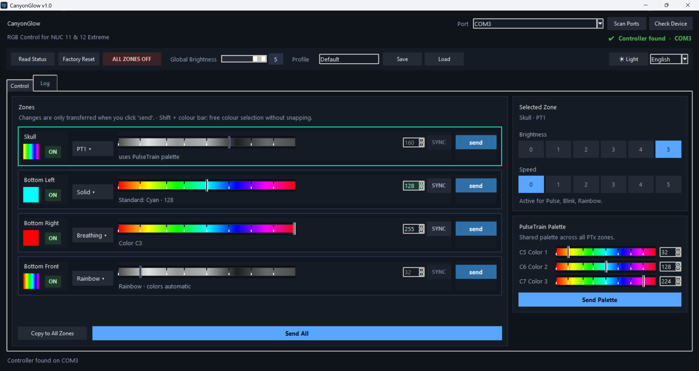
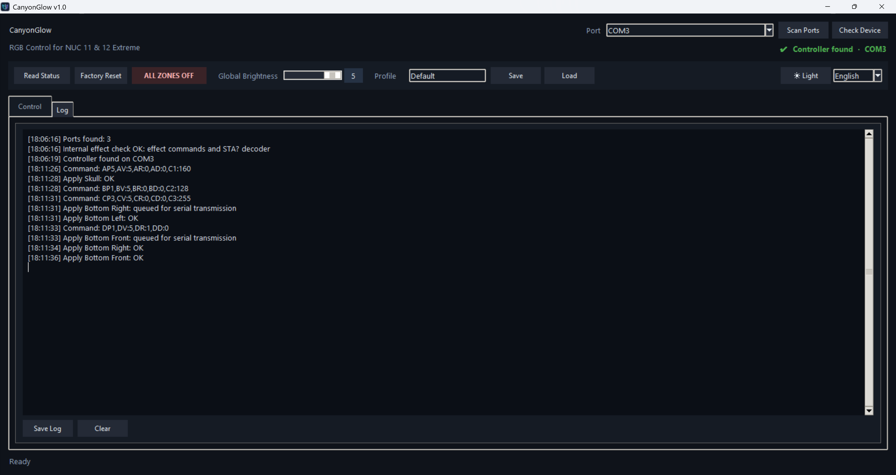

# CanyonGlow v1.0

**RGB Control for NUC 11 & 12 Extreme**

Control the four RGB LED zones on the Intel NUC 11 Extreme (Beast Canyon)
and NUC 12 Extreme (Dragon Canyon) through their built-in RGB controller.

**[Download & installation](#installation-and-startup-windows)**
· [English guide](README_EN.md) · [Deutsche Anleitung](README_DE.md)

## Hardware compatibility

| Model | Codename | Typical kit IDs | Test status |
|---|---|---|---|
| Intel NUC 11 Extreme | Beast Canyon | NUC11BTMi7, NUC11BTMi9 | Tested on hardware |
| Intel NUC 12 Extreme | Dragon Canyon | NUC12DCMi7, NUC12DCMi9 | Not yet tested on hardware |

CanyonGlow is intended for these two model families. Other NUC models are
not supported.

## Installation and startup (Windows)

For **Windows 10/11 (x64)**. Python and its packages are bundled;
Intel NUC Software Studio is not required.

- **[Download installer (.exe)](https://github.com/rattensuppe/CanyonGlow/releases/download/v1.0/CanyonGlow-v1.0-Setup-x64.exe):**
  recommended for most users. Run the setup for a per-user installation with
  a Start Menu shortcut and an optional desktop shortcut.
- **[Download portable ZIP](https://github.com/rattensuppe/CanyonGlow/releases/download/v1.0/CanyonGlow-v1.0-Portable-x64.zip):**
  fully extract the archive and run `CanyonGlow.exe` inside the `CanyonGlow`
  folder. Keep the entire folder together, including `_internal`.

[Checksums (SHA-256)](https://github.com/rattensuppe/CanyonGlow/releases/download/v1.0/CanyonGlow-v1.0-SHA256SUMS.txt)
· [Release notes](https://github.com/rattensuppe/CanyonGlow/releases/tag/v1.0)

The packages are currently unsigned.

CanyonGlow communicates with the **built-in RGB controller** via its
USB-to-serial connection. This is the same controller used by
[Intel NUC Software Studio](https://www.asus.com/au/support/faq/1056240/),
whose support ended in 2024. Windows Update normally supplies the required
Prolific serial driver, so it is usually already installed on an up-to-date
Windows system.

On the tested NUC 11 Extreme, Device Manager lists the built-in connection as
**Prolific PL2303GD USB Serial COM Port** under **Ports (COM & LPT)**
(driver provider: **Prolific**). If the driver is unexpectedly missing, see the
[driver instructions](drivers/README_EN.txt) for Windows Update and the official
Prolific download.

## Features

- Four independent zones: **Skull**, **Bottom Left**, **Bottom Right** and **Bottom Front**.
- Effects: **Solid**, **Pulse**, **Breathing**, **Strobe**, **Rainbow** and **PT1 / PT2 / PT3**.
- Colour, brightness and effect speed controls; **SYNC** links hue changes between zones.
- Shared three-colour **PulseTrain palette** for all PTx zones.
- Save and load **JSON profiles**, with an included example.
- **English/German** interface and tooltips, with saved language and **dark/light mode** preferences.

## First use

1. Start CanyonGlow and wait for automatic controller detection.
2. Choose zone settings or load a profile. Changes initially affect only the interface.
3. Click **Send All** to apply all zone settings and the shared palette.
   Use **send** in a row for one zone, or **Send Palette** for the palette and
   the selected PTx zone's settings.

Sending is available once the controller has been detected and global lighting
is switched on. **Global ON/OFF and Factory Reset act on the controller immediately.**

The log shows commands, status messages and controller responses. It can be
saved or cleared; application messages follow the selected language.

Show the log view

## Updating and uninstalling

Run a newer setup to update the existing installation. Language and appearance
preferences are retained. Uninstall through **Apps** in Windows Settings;
user-created profile files are not deleted. The portable version needs no
installation or uninstallation.

## Documentation

The full [English](README_EN.md) and [German](README_DE.md) user guides cover
all controls, profile files and serial communication details.
For running from source or building a Windows release, see the developer guide
in [English](BUILDING_EN.md) or [German](BUILDING_DE.md).

## License and acknowledgements

Independent project, with no official support from Intel or ASUS.
CanyonGlow and its original icon use the [MIT license](LICENSE),
Copyright (c) 2026 rattensuppe. Third-party attribution and license details are
in [THIRD_PARTY_NOTICES.txt](THIRD_PARTY_NOTICES.txt).

**Use at your own risk.** To the extent permitted by applicable law, CanyonGlow
is provided without warranty and its authors are not liable for damage arising
from its use, including incorrect parameters or settings. See the [MIT license](LICENSE).

Thanks to Alvin Zhu's [nuc_rgb](https://github.com/AlvinZhu/nuc_rgb) project
for the serial-protocol reference.

Created with assistance from [Claude Code](https://claude.ai/code) (Anthropic)
and Codex (OpenAI).
